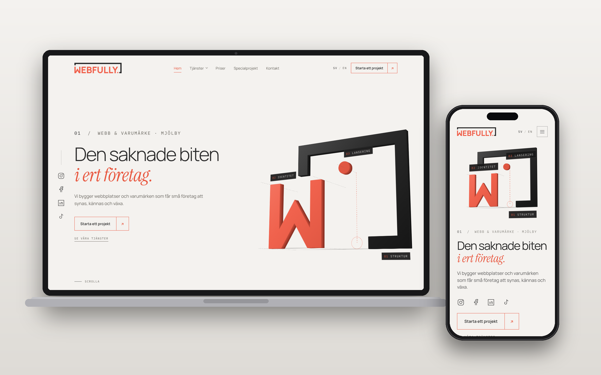

# WebFully

The website of WebFully, a digital studio in Mjölby, Sweden. One set of templates and content files produces a fast static site and a custom WordPress theme, in Swedish and English.

---



---

## Contents
1. [Live Site](#live-site)
2. [Overview](#overview)
3. [Project Summary](#project-summary)
4. [Target Audience](#target-audience)
5. [Services and Pricing Model](#services-and-pricing-model)
6. [User Experience (UX)](#user-experience-ux)
   1. [Strategy / Site Goals](#strategy--site-goals)
   2. [Scope / Pages](#scope--pages)
   3. [Structure / Design Choices](#structure--design-choices)
   4. [Surface](#surface)
      1. [Colour Scheme](#colour-scheme)
      2. [Typography](#typography)
      3. [Buttons and Corners](#buttons-and-corners)
7. [Features](#features)
   1. [Existing Features](#existing-features)
   2. [Future Features](#future-features)
8. [Technologies Used](#technologies-used)
9. [How It Is Built](#how-it-is-built)
   1. [Content Model](#content-model)
   2. [Folder Structure](#folder-structure)
10. [Testing](#testing)
11. [SEO](#seo)
12. [Deployment](#deployment)
    1. [Local Development](#local-development)
    2. [Build Commands](#build-commands)
    3. [Deploy Flow](#deploy-flow)
    4. [Content and Images](#content-and-images)
13. [Credits](#credits)

---

## Live Site
🔗 [WebFully Live Site](https://webfully.se)

---

## Overview
WebFully is the studio's own website. It presents eight services, a two-package price list, special projects and a contact form.  
The pages are written once, as templates and JSON content, and rendered by two engines that produce identical HTML: a Python build for the static site and a PHP twin inside the WordPress theme.  
WordPress is only the editor and the mail sender. There is no page builder.  
The site is available in Swedish and English and works on desktop, tablet and mobile.

---

## Project Summary

The site is the studio's front door: it explains what WebFully builds, shows examples of each service, states clear prices and makes it easy to get in touch. It is designed to feel spacious, premium and technical, and to be fast enough that the speed itself is part of the pitch.

The visual idea is a single coral dot that travels through the page, from the hero to the footer logo, and links the sections into one story. Motion is built with GSAP and runs on the home page for every visitor.

The studio is presented as an entity: the site shows no personal name, face or team size.

---

## Target Audience

The site is aimed at small and medium-sized companies in Sweden that need a website, a visible brand or help being found online. These are owner-run businesses such as builders, salons, shops and clinics, who want a clear offer, a fixed price and one partner for web, search, brand, content and ads.

The site also serves visitors who arrive from search engines and AI assistants with a concrete question, such as "who builds fast websites in Mjölby", and need a straight answer on the first screen.

---

## Services and Pricing Model

WebFully sells services directly to businesses. The site presents eight services, each with its own page:

| Service | Page |
|---|---|
| Web | `/services/web/` |
| SEO and AEO | `/services/seo-aeo/` |
| Support and hosting | `/services/support/` |
| Branding | `/services/branding/` |
| Content | `/services/content/` |
| Ads | `/services/ads/` |
| Consulting | `/services/consulting/` |
| Apps | `/services/apps/` |

The home page shows two website packages with a yearly and monthly switch, a list of add-ons and a custom offer. The prices live in `content/site.json`, so they are changed in one place.

---

## User Experience (UX)

### Strategy / Site Goals
- Explain the studio's services in plain language.
- Show one concrete example for each service.
- State prices openly.
- Turn a visit into a contact request with as few steps as possible.
- Stay fast, accessible and readable on any device.
- Be found by both search engines and AI assistants.

### Scope / Pages

| Page | URL (Swedish at the root, English under `/en/`) |
|---|---|
| Home | `/` |
| Eight service pages | `/services/<slug>/` |
| Special projects | `/special-projects/` |
| Contact | `/contact/` |
| Privacy policy | `/privacy/` |
| Error pages | `/404.html`, `/500.html` |

The home page runs in this order: hero scene, chapters (one sticky card per service), process, pricing, special projects teaser, services ticker, testimonials, call to action and footer.

### Structure / Design Choices
- Each section is its own template with its own CSS and JavaScript file, so a part can be changed without touching the others.
- Visitor text lives in `content/`, never in templates.
- The Swedish and English pages have the same structure and are linked with `hreflang`.
- Inner pages follow one pattern: page hero, three example cards, working phases, one proof image, frequently asked questions, related services and a call to action.
- Navigation is dark and floats over the page. The footer, mobile menu and cookie panel are dark too.

### Surface

The design is built on black and charcoal with a single coral accent. Coral accompanies the black and never dominates.

#### Colour Scheme

| Hex | Name | Usage |
|---|---|---|
| `#F0624D` | Brand coral | Logo, the travelling dot, text and buttons on dark backgrounds. |
| `#E8573F` | Text coral | Large text and accents on light backgrounds. |
| `#2A2A2A` | Charcoal | Text on light backgrounds. |
| `#050505` | Black | Base of the dark areas. |
| `#111111` | Soft black | Alternate dark sections. |
| `#F4F2EF` | Light | Light section backgrounds. |

> **Theme principle:** Light content areas for readability, dark navigation and footer for contrast, and one coral accent for the logo dot and calls to action.

---

#### Typography
- **Manrope** (light weight) for the base text and all headings.
- **Instrument Serif**, italic, only for the coral accent word in a heading.
- **IBM Plex Mono** for small numbered labels.
- All three fonts are self-hosted, so no visitor data goes to a font service.
- Minimum visible text size is 13px, except the small mono labels.

---

#### Buttons and Corners
- Corners are sharp everywhere, like the logo.
- Primary buttons use the coral outline on dark backgrounds; the same coral family is used for focus and hover states.
- The "Start a project" buttons lead to the contact section of the page, or to the contact page where there is none.

---

## Features

### Existing Features

- **Swedish and English versions**  
  Every page exists in both languages, with a language switch in the navigation and the footer.

- **Travelling dot journey**  
  A coral dot moves through the home page, drops from the services ticker to the call to action and lands in the footer logo.

- **Sticky service chapters**  
  The home page shows one card per service as the visitor scrolls.

- **Pricing with a yearly and monthly switch**  
  Two packages, add-ons and a custom offer, with a sheet dialog for details.

- **Service pages with examples**  
  Each service has three example cards, working phases, a proof image, frequently asked questions and related services.

- **Client testimonials**  
  Two quotes on the home page with the client logo. The client name links to the client's own site.

- **Contact form**  
  Sent by email through the WordPress theme, with validation on the client and the server.

- **Cookie consent**  
  Only necessary cookies by default. Statistics and marketing are asked for first.

- **Editable content in WordPress**  
  Text, company details and images can be edited in the WordPress admin, and fall back to the files shipped with the theme.

- **Custom error pages**  
  Custom 404 and 500 pages in both languages.

- **Responsive layout**  
  The layout, the motion and the dot journey adapt to desktop, tablet and phone.

### Future Features

Future improvements could include a client area for approving work, a booking calendar connected to the contact form, a dark theme (the switch exists and is hidden for now), and more client stories as projects are completed.

---

## Technologies Used

### Languages
- HTML5
- CSS3
- JavaScript
- Python 3
- PHP 8

### Frameworks, Libraries, and Packages
- WordPress, as editor and mail sender only
- GSAP and ScrollTrigger for motion (included in `js/vendor/`)
- Python standard library only for the build; nothing is installed

### Hosting and Deployment
- GitHub Actions to build, test and publish the theme
- Hostinger for hosting, with automatic deploys from the `deploy` branch
- LiteSpeed Cache on the server

### Tools and Services
- Git and GitHub for version control
- VS Code for development
- Google Fonts source files, self-hosted
- WebP for all images

---

## How It Is Built

### Content Model

The site has no database of its own. Content is JSON:

- `content/site.json` holds shared data: languages, pages, services, prices, company details and links.
- `content/<language>/common.json` holds shared text such as navigation and the footer.
- `content/<language>/pages/` holds one file per page.
- `content/<language>/services/` holds one file per service.

Both renderers read these files. On the live site a value saved in the WordPress admin takes precedence over the file.

### Folder Structure

| Folder | Content |
|---|---|
| `content/` | Text and data, `sv/` and `en/`, plus `site.json` |
| `src/` | Build script and templates |
| `css/`, `js/` | One stylesheet and one script per part of the site |
| `assets/` | Logos, icons, fonts, share images, client logos and service images |
| `wordpress/` | The theme's PHP, admin editor and tests |

---

## Testing

The theme is tested on every push by the deploy workflow:

- **Parity test** (`wordpress/tests/render.php`): renders every page with the theme's PHP and compares it with the static build. All 26 pages, the sitemap, `robots.txt` and `llms.txt` must be identical.
- **Smoke test** (`wordpress/tests/wp-smoke.php`): checks the theme's routes and functions with WordPress functions replaced by stand-ins.
- **Syntax check:** `php -l` on every PHP file of the theme.
- **Link and asset check:** every internal link and image in the build points to a file that exists.
- Manual checks in the browser on desktop and mobile, with measured values for sizes and positions.

---

## SEO

- One `<h1>` per page, descriptive page titles and meta descriptions in the page language.
- Canonical links and `hreflang` between the Swedish and English pages.
- Open Graph and Twitter card tags, with a share image for each language.
- Structured data as JSON-LD: Organization and LocalBusiness.
- `sitemap.xml`, `robots.txt` and `llms.txt`, written by both renderers.
- A real `alt` text in Swedish for every image, with English `alt` text on the English pages.
- Self-hosted fonts, long browser caching for theme files and WebP images for short load times.
- A redirect from `www` to the main address.

---

## Deployment

### Local Development

Python 3.8 or later is needed. Clone the repository and run:

```
python3 src/build.py --serve
```

The site opens on http://localhost:5500 and is rebuilt on every change. Stop it with `Ctrl+C`.

### Build Commands

```
python3 src/build.py            # build once into dist/
python3 src/build.py --theme    # build the WordPress theme into theme/webfully/
php wordpress/tests/render.php  # parity test (needs PHP 8)
php wordpress/tests/wp-smoke.php
```

Run both build commands before the tests. `dist/` and `theme/` are generated and are not committed.

### Deploy Flow

Every push to `main` runs `.github/workflows/deploy.yml`:

1. Builds the static site and the theme.
2. Runs the syntax check, the parity test and the smoke test.
3. Publishes the theme files to the `deploy` branch.

Hostinger pulls the `deploy` branch into `wp-content/themes/webfully`. A push reaches the live site in about a minute. As a fallback, `theme/webfully.zip` can be uploaded in WordPress under Appearance, Themes.

### Content and Images

- Text lives in `content/`. File names are English, lowercase and with hyphens.
- Images are WebP and are compressed before they are committed. Paths in the content files start with `/assets/` and the theme adds its own URL on WordPress.
- The Swedish search text goes in the `alt` field of each image.

---

## Credits

The following resources and tools were used during development:

- **Manrope, Instrument Serif and IBM Plex Mono** for typography, under the SIL Open Font Licence (licence files are in `assets/fonts/`)
- **GSAP and ScrollTrigger** for motion
- **WordPress** as the editor and mail sender
- **Hostinger** for hosting
- **GitHub Actions** for building and deploying

The logo, design, copy structure and code were created for this project.

---

[Back to Top](#webfully)
